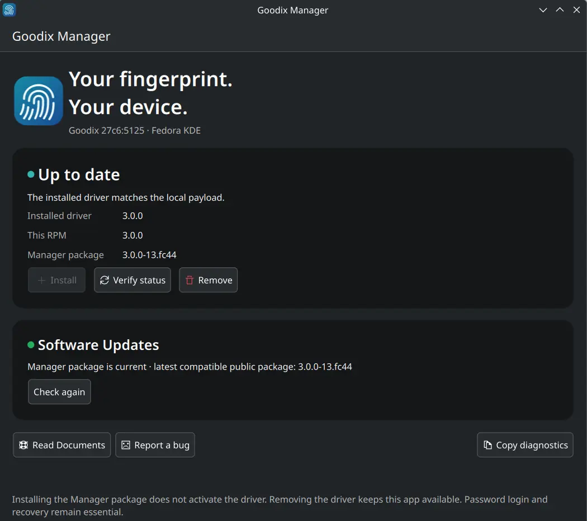

<!-- SPDX-License-Identifier: GPL-2.0-or-later -->
# Install the Goodix Fingerprint Driver

**Fedora KDE · Goodix USB `27c6:5125`**

Install **Goodix Manager** with KDE Discover, then use it to activate the fingerprint driver. Keep your normal password login available.

## Quick start

### 1. Download Goodix Manager

Open the **[official GitHub Releases](https://github.com/sorguido/goodix-27c6-5125/releases)** and download the latest compatible RPM from **Assets**. Its name looks like `goodix-manager-…fc44.x86_64.rpm`.

### 2. Install the RPM

Double-click the downloaded file, open it with **KDE Discover** and choose **Install**.

### 3. Activate the driver

Open **Goodix Manager** from your KDE application menu and click **Install**. Approve the authorization prompt, wait for completion and restart if requested.



*Goodix Manager after installation. On a new installation, the **Install** button is enabled; after installation, the status can show **Up to date**.*

### 4. Register your fingerprint

Go to **System Settings → Users → Fingerprint Authentication** and follow the prompts. Lift your finger after each touch and slightly change its position each time.

### 5. Use fingerprint login

At the Plasma login screen, submit the **empty password field** once to select fingerprint authentication. Follow the prompt to touch the reader. You can still log in with your password; use it after three unsuccessful fingerprint attempts.

## Updating the driver

Open **Goodix Manager** occasionally to check for updates. It checks official releases when launched; you can also click **Check again**.

If **Download RPM** appears:

1. Click **Download RPM**. Your browser opens the direct download link for the new RPM.
2. Close Goodix Manager, then double-click the downloaded RPM and install it with **KDE Discover**.
3. Reopen Goodix Manager and click **Apply Update**, if offered. Follow any restart instructions.

Installing a newer RPM alone does **not** update the active driver. If the release check reports **Check unavailable**, try **Check again** later.

**Upgrading from a 2.x version?** For a recognized, intact installation, Goodix Manager offers **Upgrade to 3.0.0**. No preliminary uninstall is needed, but **you must register your fingerprints again** after the upgrade. Existing fingerprint files and pairing data are preserved.

## Removing the driver

Open **Goodix Manager**, select **Remove** and restart if requested. This leaves Goodix Manager available for future reinstallations.

> [!IMPORTANT]
> Uninstalling the **Goodix Manager RPM** does **not** remove an activated driver. To remove the driver, use **Remove** inside Goodix Manager first.

## Need help?

If an operation fails, use **Copy diagnostics** in Goodix Manager and [report the problem](https://github.com/sorguido/goodix-27c6-5125/issues). Do not share fingerprint images, templates or pairing secrets.

If login or normal removal is unavailable, follow the [recovery guide](UNINSTALL.md). Do not change Fedora authentication settings or disable SELinux to work around an error.

<details>
<summary><strong>Optional: Verify the RPM's digital signature</strong></summary>

Verifying the RPM before installing it helps detect a replaced or altered package. The check is optional in this quick-start guide; **downloading from GitHub alone does not verify the signing identity**.

Download the [public signing key](../packaging/rpm/keys/Guido-Soraru.asc) as `Guido-Soraru.asc` into the same folder as the RPM. Open that folder in **Dolphin** and press **F4** to open a terminal there.

Check the key fingerprint:

```bash
gpg --show-keys --with-fingerprint Guido-Soraru.asc
```

The expected fingerprint is:

```text
5FB2 0F58 3C83 1729 D5FF 073F E99A DAE5 B7EA 4918
```

To confirm who signed the package, compare that fingerprint with a copy obtained through an **independently trusted channel**. A matching fingerprint on this page and a key from the same repository are not independent proof of identity.

Then import the key and verify the RPM:

```bash
sudo rpmkeys --import Guido-Soraru.asc
rpmkeys --define '_pkgverify_level all' --checksig --verbose goodix-manager-*.fc44.x86_64.rpm
```

Check that the **signature and digest checks report `OK`** and the signing key matches the expected identity. Stop if the signature is missing or a check fails; do not disable signature verification. KDE Discover should not be assumed to perform this independent verification for you.

</details>

For more information, see [supported configurations and limitations](VALIDATION.md), [uninstallation and recovery](UNINSTALL.md), or the [technical manual](../TECHNICAL_MANUAL.md).
