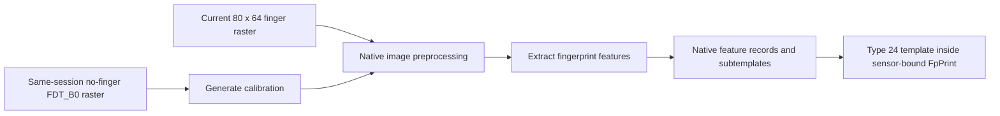

<!-- SPDX-License-Identifier: GPL-2.0-or-later -->
# 5. From image to fingerprint template

## A photograph is not the best comparison tool

Suppose you take two photos of the same finger. The finger may be shifted,
rotated, pressed more firmly, or slightly drier in one photo. Comparing the two
images pixel by pixel would be fragile.

Biometric software therefore looks for a more useful representation: stable,
distinctive structures that can still be compared when the pictures are not
identical.

That reusable representation is called a **template**.

## The project-specific image pipeline

The driver uses a native biometric engine called **ChicagoHS**. The image is
calibrated, processed and converted into features that form a stored Type 24
template. Those operations happen in the Goodix-enabled `libfprint` runtime,
not inside Fedora's login screen.

The path is:



### 1. Raw raster

The decoder produces 5,120 values. Each describes one small location on the
sensor.

### 2. Preprocessing

The current driver uses the same-session no-finger `FDT_B0` image as the
input to calibration generation. The native biometric engine
generates gain/offset state and processes the 80×64 unsigned 12-bit finger
raster with its own native preprocessing. A separate 8-bit rendering, if
supplied to libfprint, is for display and not for biometric matching.

This is closer to preparing a scanned page before optical character recognition
than to recognizing the person directly. It improves the input; it does not
make the final identity decision. The relationship between the 5125 USB
`FDT_B0` and the upstream SPI T0/ImageBase is supported by initial functional
results, but not proven physically identical across devices.

### 3. Feature extraction

The matcher extracts **native feature records** from each processed
finger image. These records are used to construct subtemplates with the native
Type 24 enrollment and matching policy. The feature format and its scoring
must not be reduced to an ordinary pixel-by-pixel image comparison.

Many fingerprint explanations use the word **minutiae** for ridge endings and
bifurcations. That is a useful general concept, but it would be misleading to
say this driver's saved Type 24 data is only a classic minutiae list. Its
actual stored representation uses the engine's native subtemplate format.

### 4. Template sample

The extracted representation becomes a native subtemplate. The original
twelve-stage enrollment policy can retain several subtemplates, including
some contacts that do not advance the visible enrollment stage because of
position guidance. When complete, the packed native template is wrapped
inside a sensor-bound `FpPrint` so later touches have useful references.

## What is saved—and what is not

The template is not meant to be a normal photograph. `libfprint` serializes
the native Type 24 representation within a RAW FpPrint envelope,
including its backend identity and OTP-bound device information. The raw
fingerprint raster is not the normal stored identity record. Templates made
by older biometric engines are preserved but cannot be
matched or converted by the current implementation.

This does not make templates harmless. A biometric template is sensitive
personal data and must not be published, attached to bug reports, or committed
to source control.

## Matching is a score, then a decision

During verification, the driver preprocesses the new probe once and uses
its original matching algorithm to evaluate the stored Type 24 template.
The native selector threshold is 207; the final match decision is
`score > 0`, without application-specific threshold adjustments.

```text
new extracted probe
    │
    ├─ validate current reader and stored Type 24 template
    ├─ evaluate stored native subtemplates
    └─ apply the original native match policy

valid native match score > 0  → MATCH
valid native match score <= 0 → NO MATCH
invalid data or failed engine → ERROR (never a fabricated NO MATCH)
```

Those implementation thresholds are not statements that the fingerprints
are mathematically identical, nor are they measured FAR/FRR guarantees.

## Features are not identity by themselves

A feature sample has no Linux username magically embedded in it. The username,
finger label, device compatibility information, and samples are assembled by
the host software into a stored record. `fprintd` associates that record with
the user account and finger label.

The sensor does not receive a list of local Linux users and does not choose one.

> 🔎 **Want to see this in the repository?**
> The USB background and capture lifecycle are connected in
> [`goodix_fpimage_device.c`](../../libfprint-driver/goodix_fpimage_device.c).
> The native biometric adapter, probe, enrollment, matching and
> sensor-bound serialization are in
> [`goodix_chicago.c`](../../libfprint-driver/goodix_chicago.c)
> and the pinned [native source files](../../production/chicago-native/).

## ✅ What to remember

- Pixel-for-pixel comparison would be too fragile.
- Preprocessing prepares the image; it does not identify the user.
- The stored representation is native Type 24 subtemplates,
  rather than an ordinary grayscale image or classic minutiae list.
- Enrollment can retain more subtemplates than the twelve stages it advances.
- The native matcher applies its original scoring and decision
  without relaxing quality or matching conditions.
- Templates are sensitive biometric data even though they are not ordinary
  fingerprint photographs.

---

[← Previous: From finger to image](04_from_finger_to_image.md) | [Up: Learning home](README.md) | [Next: Enrollment →](06_enrollment.md)
