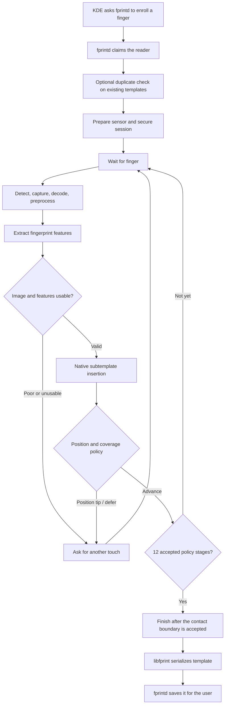

<!-- SPDX-License-Identifier: GPL-2.0-or-later -->
# 6. Enrollment

## 👀 What you see

KDE asks you to touch and lift the same finger several times. A progress
indicator advances until the finger is enrolled.

It can feel repetitive, but each useful touch sees a slightly different part
or pressure pattern.

## 🏠 A simple analogy

Imagine teaching someone to recognize a handwritten signature. One example is
helpful, but several natural examples show what changes and what stays stable.

Fingerprint enrollment does the same kind of job:

```text
one finger, several views → a reusable reference
```

It does **not** average the images into a prettier photograph. Each useful
view contributes extracted features and a native subtemplate.
Some retained subtemplates do not advance the visible enrollment progress:
the engine also checks how the finger is positioned.

## 🗺️ The enrollment flow



## How many touches?

The driver uses a **twelve-stage enrollment policy**. Stages count
accepted biometric progress, not simply how many times a finger touches
the reader:

- Enrollment completes only when twelve native **policy stages** have advanced.
- The backend can retain a subtemplate even when position guidance asks for
  another touch and the visible stage does not advance.
- Poor or unusable images can request another scan without advancing the
  policy. Invalid protocol, template or binding data instead fails closed.
- The policy includes original position tips and a controlled
  **defer/drop/restore** behavior, preserving the upstream ordering rather
  than forcing every image into the gallery.
- The number of physical contacts and the number of retained subtemplates
  therefore need not be twelve. More contacts may be required naturally.
- The driver does not bypass image-quality or position rules to force
  a completed enrollment, nor does it reinterpret rejected images as valid.

A request to reposition the finger is normal feedback. The visible progress
does not necessarily advance after every physical touch, and a successful
enrollment may therefore take more than twelve contacts. The distinction
between policy stages and physical touches matters more than the count alone.
Evidence and limitations of the tested reader are recorded in
[Validation](../VALIDATION.md).

## Why lifting the finger matters

A physical touch is not finished the instant its image is available. In the
ordinary path, the driver observes the release boundary and completes the
protocol tail before arming the next stage.

Enrollment also handles a specific zero-mask sensor report by keeping the image
already captured and skipping the extra acquisition. Normal sample checks still
apply before another touch is requested; a final sample can complete without a
separate release notification. The [technical manual](../../TECHNICAL_MANUAL.md#74-enrollment-zero-mask-recovery)
describes this bounded rule and its remaining late-event limitation.

Keep following the touch-and-lift prompts. The driver does not silently take
unlimited pictures while you hold the finger in place.

## Who is responsible for what?

| Component | Enrollment responsibility |
| --- | --- |
| KDE settings | Shows the user interface and progress. |
| `fprintd` | Checks permission, claims the reader, starts/stops enrollment, labels the finger, and saves the completed record. |
| `libfprint` | Builds the host template, reports progress, serializes the result, and coordinates image processing. |
| Goodix driver | Prepares the reader and performs bounded finger detection, image capture, release, cancellation fences and native twelve-stage progress reporting. |
| Native biometric engine | Generates calibration from the no-finger image, preprocesses frames, extracts features and enforces the original twelve-stage policy, including position tips and deferred subtemplates. |
| Sensor | Measures the finger and returns device data; it does not save the Linux user's final template in this project. |

## What happens when a sample is poor or repetitive?

Four outcomes are easy to confuse:

- **accepted:** the contact has usable fingerprint features and the native
  position policy advances one of the twelve stages;
- **position tip:** a usable native subtemplate may be retained without
  advancing the stage; the next touch should cover a different position;
- **retry:** the contact was consumed but the image or native policy needs
  another touch; no unsupported successful stage is fabricated;
- **fatal processing or protocol error:** enrollment stops safely rather than
  hiding another sensor acquisition.

The current driver deliberately fails closed after certain processing failures.
That prevents a completed sensor-side acquisition from silently turning into an
unexpected extra contact.

## When does saving happen?

The driver does not write the finished template into the sensor. It hands the
accepted samples to `libfprint`. `libfprint` serializes the biometric
representation, and `fprintd` stores it under the host's fingerprint storage
area for the selected user and finger label.

That division becomes important during uninstall: removing the driver can
preserve the user's templates for later reinstallation.

> 🔎 **Want to see this in the repository?**
> The enrollment adapter is in
> [`goodix_chicago.c`](../../libfprint-driver/goodix_chicago.c), with the
> unchanged native position policy in
> [`goodix-chicago-enrollment.c`](../../production/chicago-native/chicago/goodix-chicago-enrollment.c).
> The device's protocol-stage model remains in
> [`goodix_enrollment_model.c`](../../libfprint-driver/goodix_enrollment_model.c);
> the earlier diversity helper does not determine the current
> admission policy.

## ✅ What to remember

- Enrollment teaches the host using several views of one finger.
- Usable contacts contribute native subtemplates to the gallery.
- The native policy advances exactly twelve accepted stages;
  physical contacts and retained subtemplate counts can differ. Initial
  enrollment completed on one real reader; longer-term performance is open.
- Each stage follows its contact-completion rules before requesting another touch.
- `fprintd` saves the completed host template; the sensor does not become a
  database of Linux users.

---

[← Previous: From image to template](05_from_image_to_template.md) | [Up: Learning home](README.md) | [Next: Verification and matching →](07_verification_and_matching.md)
